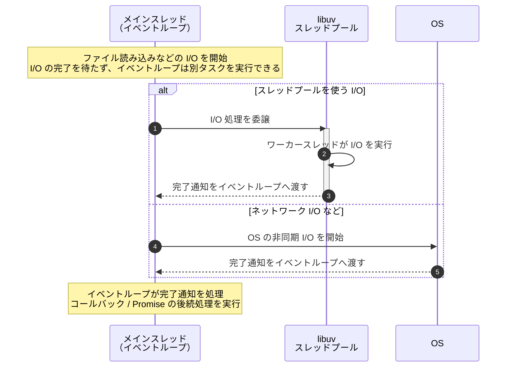

# ブログ用の図

このディレクトリは、CMS にアップロードする図のソースと PNG の保管場所です。サイトからは配信しません。

- `*.mmd`: Mermaid の編集用ソース
- `*.png`: CMS に貼り付ける生成済み画像

## 図を更新する

1. 対応する `.mmd` を編集する
2. リポジトリのルートで次を実行する

```sh
npm run diagrams:build
```

`blog-assets/` 以下にあるすべての `.mmd` を、同じ場所・同じ名前の `.png` に生成します。たとえば `diagrams/mTLS.mmd` は `diagrams/mTLS.png` になります。配色や余白は `mermaid-tokiolab.json` で調整します。

## Node.js のノンブロッキング I/O とスレッドプール

`memo.txt` の内容は概ね正しいですが、次の点を補足するとより正確です。

- Node.js のメインスレッドが I/O の完了を待たず、別のタスクを進める点は正しい
- ファイルシステム操作、`dns.lookup()`、一部の暗号処理などは、libuv のスレッドプールに委譲される
- ネットワーク I/O の多くは OS の非同期機構とイベントループで処理され、スレッドプールを使うとは限らない
- 処理完了後は、スレッドプールからメインスレッドへ直接処理が戻るのではなく、完了通知がイベントループに渡され、コールバックや Promise の後続処理が実行される



編集用の Mermaid ソースは [`diagrams/nodejs-nonblocking-threadpool.mmd`](./diagrams/nodejs-nonblocking-threadpool.mmd) にあります。

詳細な処理の流れは、I/O の種類ごとに次の図へ分けています。

- [ファイル I/O のシーケンス図](./diagrams/nodejs-file-io-threadpool.png)
- [ネットワーク I/O のシーケンス図](./diagrams/nodejs-network-io-event-loop.png)
- [`fs/promises` と `await` の実行順序](./diagrams/nodejs-fs-promises-await.png)
- [複数 HTTP リクエストとイベントループ](./diagrams/nodejs-http-multiple-requests.png)
- [Node.js イベントループのフェーズ](./diagrams/nodejs-event-loop-phases.png)

イベントループの図は、理解しやすさを優先した簡略版です。libuv の内部には `idle / prepare` などのフェーズもあります。
